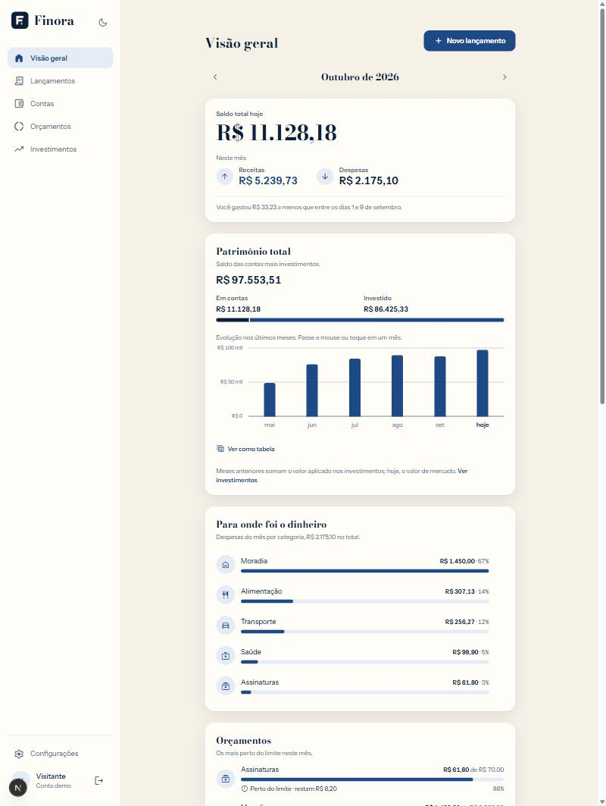
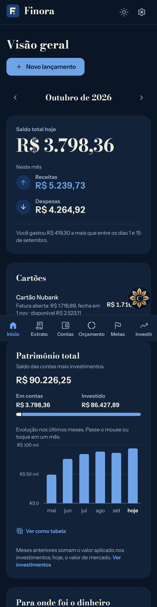
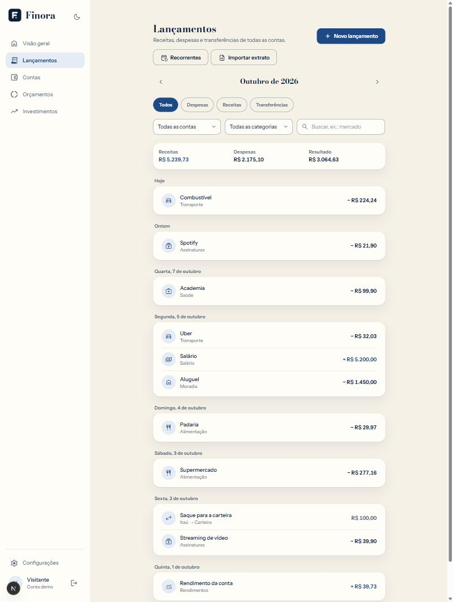
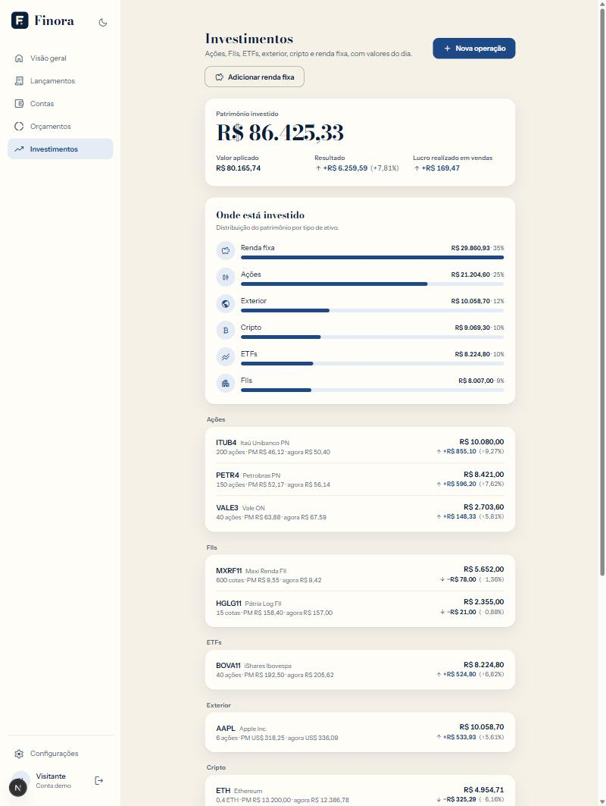
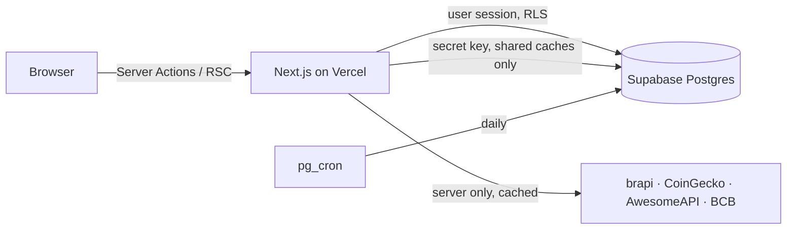

<p align="center">
  
</p>

<h1 align="center">Finora</h1>

<p align="center">Personal finance, with clarity. A full-stack portfolio project.</p>

<p align="center">
  
  &nbsp;
  
</p>

---

Finora shows where money comes in and, above all, where it goes out, then follows it into
investments with live quotes. The interface is in Brazilian Portuguese; code and docs are in
English. Try it with **"Entrar como demo"**: a sample account with six months of data that resets
every night.

## Features

**Sign-in**
- Email and password, Google, or a one-click demo account.

**Money in and out**
- Accounts (checking, savings, wallet, credit card) with live balances and transfers.
- Transactions with month navigation, filters by type, account and category, search, and day grouping.
- Dashboard: balance, month income and expenses compared with the same days of last month,
  spending by category, six-month income vs. expenses chart, largest expenses, net worth over time.
- Credit card bills: closing and due days, open/closed/paid/overdue status, installments ("3x")
  spread over the next bills, one-click bill payment and available limit.
- Monthly budgets per category, with near-limit and over-limit alerts.
- Recurring transactions (salary, rent, subscriptions) created daily by a database job.
- Bank statement import (OFX and CSV) with category suggestions learned from your own history,
  duplicate detection and one-click undo.

**Investments**
- Stocks, FIIs, ETFs, US stocks and crypto with quotes from brapi.dev, CoinGecko and AwesomeAPI.
- Average-cost positions (the Receita Federal method), realized profit, allocation by class.
- Fixed income (CDB, LCI/LCA, Tesouro Selic, Prefixado, IPCA+) valued from Banco Central CDI,
  Selic and IPCA series, with the regressive income tax estimate.

**Quality**
- Row Level Security on every table; privileged code isolated in a private schema.
- 100+ unit tests on the money, date, import, position and fixed income math.
- End-to-end tests (Playwright) for sign-in, the demo account and the transaction flow, run
  against a throwaway user that is created and deleted on every run.
- CI on every push: lint, type check, unit tests, build and end-to-end tests.
- Error monitoring without a third-party service: server errors (`onRequestError`) and browser
  errors are stored in a private table for 30 days; `npm run errors` lists them.
- Light and dark themes with no flash, accessible charts (legend, readout, table view), phone layout.

<p align="center">
  
  &nbsp;
  
</p>

## Tech stack

- **Next.js 16** (App Router, Server Actions, Cache Components, Proxy) + **TypeScript**
- **Tailwind CSS 4** with tokens from the Finora design system
- **Supabase**: Postgres, Auth, Row Level Security, `pg_cron`
- **Zod** for form validation, **Vitest** and **Playwright** for tests, **GitHub Actions** for CI
- Market data: [brapi.dev](https://brapi.dev), [CoinGecko](https://www.coingecko.com/),
  [AwesomeAPI](https://docs.awesomeapi.com.br/), [Banco Central SGS](https://dadosabertos.bcb.gov.br/)
- Hosting: **Vercel**

## Architecture



- **Reads** go through a small data access layer (`src/lib/data/*`) that verifies the session with
  `getCurrentUser()` and queries with the user's own Supabase client, so RLS always applies.
- **Writes** are Server Actions that validate with Zod and return field-level messages.
- **Aggregates** (monthly totals, spending by category, budgets, balances, month-end net worth)
  run in Postgres as `security invoker` functions and views.
- **Market data** is fetched only on the server and cached in shared tables (`quotes`,
  `index_rates`) that users can read and only the server writes.
- **Jobs** run inside the database with `pg_cron`: recurring transactions at 03:00 and the demo
  reset at 04:00 (São Paulo).

## How the numbers work

### Recurring transactions

Rules live in `recurring_rules`. `private.generate_recurring()` creates what is due, clamping
day 31 to short months. Each rule keeps `generated_until`, so generation only moves forward:
deleting a generated transaction does not bring it back, and a unique index on
`(recurring_rule_id, date)` makes reruns idempotent.

### Statement import

`/transactions/import` reads OFX (1.x SGML and 2.x XML, Latin-1 or UTF-8) and bank CSVs (Nubank
account and card exports, `;` or `,`, debit/credit columns, a title row above the header).
Nothing is saved until the review step, where each row shows:

- **a suggested category**: first from how you categorized the same merchant before
  (`category_history()`), then from built-in merchant keywords (iFood, Uber, Drogasil…);
- **duplicate flags**: the bank's own id (`FITID`) already imported, or a movement with the same
  day, direction and amount already in the account.

Every import gets an `import_batch_id`, so it can be undone in one click. Sample files at
`/samples/extrato-exemplo.ofx` and `/samples/fatura-exemplo.csv` are generated with recent dates.

### Investments and quotes

Trades (`asset_trades`) are the source of truth; positions use the average-cost method
(`src/lib/investments/position.ts`): buys raise the average price (fees included), sales keep it
and realize the difference. A sale can never exceed what was held on its date, including after
edits or deletions.

| Asset | Provider | Notes |
| --- | --- | --- |
| B3 stocks, FIIs, ETFs, US stocks | brapi.dev | Free plan: one symbol per request and one request at a time, so symbols are fetched sequentially with a retry on HTTP 429 |
| Crypto | CoinGecko | Batch request, prices in BRL; tickers resolved via search by market cap |
| USD/BRL | AwesomeAPI | Converts US positions for portfolio totals |

Quotes are cached for 15 minutes. When a provider fails, the last cached price is shown and the
page says so.

### Fixed income

Valued from Banco Central SGS series (CDI = 12, Selic = 11, IPCA = 433), cached in `index_rates`
(`src/lib/fixed-income/`):

- **% do CDI / % da Selic**: the principal compounds `1 + daily rate × percentage` on each
  business day from the start date up to the valuation date (or maturity).
- **Prefixado**: `(1 + annual rate) ^ (business days / 252)`.
- **IPCA +**: published monthly IPCA (first month pro rata) × `(1 + spread) ^ (business days / 252)`.
  Unpublished months are not counted, so it trails reality by about a month of inflation.
- Business days come from the CDI series itself (one entry per business day).
- Income tax uses the regressive table (22.5% → 15%) unless the asset is exempt (LCI/LCA).

Values are estimates: banks round differently, IOF applies in the first 30 days, and Tesouro
titles are marked to market. The UI says so.

### Credit card bills

Card math lives in `src/lib/credit-card.ts`. A bill is named after its due month and closes on the
closing day (clamped to short months); a purchase made on the closing day already goes to the next
bill. When the due day is after the closing day the bill is due that same month, otherwise the next.

- **Installments**: "3x de R$ 100" saves three transactions sharing `installment_group_id`, one
  per month on the purchase day (clamped), so each lands in its own bill and budget month. Cents
  are split exactly, with the rounding on the first one. Imported card statements keep
  "Parcela 3/12" as the installment number.
- **Payments** are transfers into the card. One counts toward the bill that closed before it (from
  that closing date to the next one), which is when people pay.
- **Available limit** is the limit minus everything owed on the card, future installments included.

### Error monitoring

`src/instrumentation.ts` catches every server error (rendering, Server Actions, Route Handlers,
proxy), writes one JSON line to the Vercel logs and calls `public.report_error()`. Browser errors
(error boundaries, uncaught errors and rejected promises) go through a Server Action, capped at
five per page load. Errors with a digest came from the server and are not reported twice. The
function trims every field, keeps only the pathname (query strings can hold search terms), caps
the table at 60 events per minute and stores them in `private.error_events`, which the public API
cannot read; a nightly job keeps 30 days. Reporting runs only in production
(`VERCEL_ENV=production`) or with `REPORT_ERRORS=1`.

### Net worth

Today's net worth is account balances plus investments at market value. Past months add the
month-end account balances (`balance_history()`) to what was invested at that date, at cost,
because historical market prices are not stored. The chart's footnote says so.

## Design

The visual identity ("Alvorada") pairs blu notte and ivory with a single touch of antique gold.
Headings use **Bodoni Moda** (optical size 14), UI text uses **Instrument Sans**, and icons are
**Material Symbols Rounded**. Tokens live in [`src/app/globals.css`](src/app/globals.css) and switch
themes through `data-theme` on `<html>`, set before first paint.

Brand rules carried into the UI: income in blue with "+", expenses in ink with "−", never red for
an ordinary expense or an investment loss; red only for real alerts (over budget, negative
balance). Charts are hand-built; the two-series palette (blue/ink) was checked for color-vision
deficiency separation and contrast in both themes, and every chart has a table view.

## Security model

- Every table has **Row Level Security**: a user can only read and write rows whose `user_id` is
  their own. Views and aggregate functions run as the caller (`security invoker`).
- Composite foreign keys (`(account_id, user_id)`) make it impossible to attach a row to another
  user's account, category, asset or rule, even with a guessed id.
- The session is refreshed in `src/proxy.ts`; that redirect is only a convenience, and
  authorization lives in RLS and `getCurrentUser()`.
- Privileged code (seeds, new-user trigger, recurring generator, demo reset) lives in a `private`
  schema the public API cannot reach. Users cannot change their own `is_demo` flag or a rule's
  `generated_until`.
- API tokens and the Supabase secret key stay on the server; the secret key is used only for the
  shared quote and index caches.

## Getting started

Requirements: Node.js 20+ and a Supabase project.

```bash
npm install
cp .env.example .env.local   # fill in Supabase, brapi and demo values
npm run db:push              # create the schema
npm run seed:demo            # create the demo account
npm run dev
```

Open http://localhost:3000.

| Script | What it does |
| --- | --- |
| `npm run dev` | Start the dev server |
| `npm run build` | Production build |
| `npm run lint` | ESLint |
| `npm test` | Unit tests (Vitest) |
| `npm run test:e2e` | End-to-end tests (Playwright; needs `SUPABASE_SECRET_KEY` to create the test user) |
| `npm run db:push` | Apply pending migrations in `supabase/migrations` |
| `npm run db:types` | Regenerate `src/lib/supabase/database.types.ts` |
| `npm run seed:demo` | Create or reset the demo account |
| `npm run errors` | Latest error events reported by production |

### Deploying to Vercel

1. Import the GitHub repository in Vercel.
2. Add the environment variables from `.env.example` (all except `SUPABASE_DB_URL`, which is only
   for local scripts).
3. In Supabase → Authentication → URL Configuration, set the Site URL to the Vercel domain and
   add `https://<domain>/**` to the redirect URLs.
4. For Google sign-in, create an OAuth client (Web application) in Google Cloud with the
   redirect URI `https://<project-ref>.supabase.co/auth/v1/callback`, then paste its client ID
   and secret in Supabase → Authentication → Sign In / Providers → Google.

## Project structure

```
src/
  app/
    (app)/              # Signed-in area: dashboard, transactions, accounts, budgets, investments, settings
    (auth)/             # Login, sign-up and their Server Actions
    auth/callback/      # Google sign-in and email confirmation handler
    samples/            # Generated sample OFX/CSV files
  components/           # brand, finance, investments, layout, ui
  lib/
    data/               # Server-only data access layer
    fixed-income/       # SGS series cache and valuation
    import/             # OFX/CSV parsers, categorization, duplicate detection
    investments/        # Positions, quotes, providers, number formatting
    supabase/           # Server, proxy and admin clients, generated types
  proxy.ts              # Session refresh + optimistic auth redirects
e2e/                    # Playwright tests
supabase/migrations/    # Schema, RLS, functions, cron jobs, demo seeds
scripts/                # db:push, db:types, seed:demo
docs/                   # MVP plan (Portuguese) and screenshots
```

## Roadmap

All eight MVP phases are done (plan in [docs/mvp-plan.md](docs/mvp-plan.md)). Next, in order
([docs/roadmap.md](docs/roadmap.md)): production hardening (custom email, Google sign-in,
end-to-end tests), credit card bills with installments, savings goals, AI insights on spending,
and finally an installable mobile app (PWA) with offline mode and notifications.
